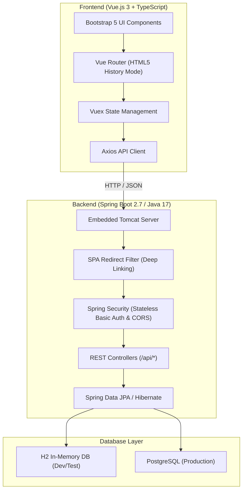

# Full-Stack Spring Boot & Vue.js Cloud Application

[](https://github.com/MK-codes365/springboot-vuejs/actions)
[](https://springboot-vuejs.onrender.com/)
[](https://adoptium.net/)
[](https://spring.io/projects/spring-boot)
[](https://vuejs.org/)
[](https://www.typescriptlang.org/)
[](https://www.docker.com/)
[](LICENSE)

An enterprise full-stack web application designed and built by **Mukut Kumar**. It combines a **Spring Boot** (Java 17) RESTful backend with a **Vue.js 3 + TypeScript** Single-Page Application (SPA) frontend, packaging both into a unified, self-contained executable JAR with cloud container deployment.

---

## Live Deployment

- **Live Web Application (Render):** [https://springboot-vuejs.onrender.com/](https://springboot-vuejs.onrender.com/)
- **Actuator Health Endpoint:** [https://springboot-vuejs.onrender.com/actuator/health](https://springboot-vuejs.onrender.com/actuator/health)
- **Public API Test:** [https://springboot-vuejs.onrender.com/api/hello](https://springboot-vuejs.onrender.com/api/hello)

---

## Architecture Overview



---

## Key Features

1. **Unified Maven Multi-Module Build:**
   - Both `backend` and `frontend` modules are managed by a root `pom.xml`.
   - `frontend-maven-plugin` installs Node/npm locally and compiles the Vue app during `generate-resources`.
   - `maven-resources-plugin` embeds the frontend assets into `src/main/resources/public`, creating a **single runnable fat JAR**.

2. **Dual-Environment Workflow:**
   - **Local Development:** Webpack dev server on port `8080` with hot-module replacement (HMR) and automatic API proxying to Spring Boot on port `8098`.
   - **Production:** A single containerized Spring Boot instance serves both static SPA assets and dynamic REST APIs.

3. **SPA History Mode & Deep Linking:**
   - Client-side routes (e.g. `/user`, `/bootstrap`, `/protected`) are handled by Vue Router without `#` hashes.
   - Spring Boot's `SpaRedirectFilterConfiguration` automatically forwards non-API direct page requests to `/index.html`, eliminating 404 errors on browser refresh.

4. **Stateless Security & CORS Support:**
   - Configured via Spring Security with HTTP Basic Authentication for protected routes (`/api/secured`).
   - Integrated with cross-origin resource sharing (CORS) rules to support distributed frontends (such as Vercel).

5. **Automated CI/CD Pipeline:**
   - GitHub Actions workflow runs on every push and pull request, executing:
     - Automated Jest unit tests for Vue.js
     - Automated JUnit 5 integration tests for Spring Boot
     - JaCoCo code coverage generation
     - Multi-stage Docker container build verification

6. **Cloud & Container Ready:**
   - Multi-stage `Dockerfile` using `maven:3.9-eclipse-temurin-17` for building and `eclipse-temurin:17-jre-jammy` for execution.
   - Fully compatible with modern Linux container runtimes (cgroups v2).

---

## REST API Endpoints

| Method | Endpoint | Access | Description |
| :--- | :--- | :--- | :--- |
| `GET` | `/api/hello` | Public | Returns greeting string |
| `POST` | `/api/user/{lastName}/{firstName}` | Public | Creates a user in the database |
| `GET` | `/api/user/{id}` | Public | Retrieves a user by database ID |
| `GET` | `/api/secured` | Basic Auth | Protected endpoint (Credentials: `sina` / `miller`) |
| `GET` | `/actuator/health` | Public | Spring Boot Actuator health status |

---

## Tech Stack

- **Backend:** Java 17, Spring Boot 2.7, Spring Security, Spring Data JPA, Hibernate, Tomcat Embedded, Maven
- **Frontend:** Vue.js 3, TypeScript, Vue Router 4, Vuex 4, Axios, Bootstrap 5, Sass
- **Testing:** JUnit 5, Mockito, Rest-Assured, JaCoCo, Jest, Vue Test Utils
- **DevOps & Cloud:** Docker, GitHub Actions, Render, Vercel

---

## Local Development Setup

### Prerequisites
- Java 17+ (JDK)
- Node.js 18+ & npm

### Running the Backend
```bash
cd backend
../mvnw spring-boot:run
```
*Backend runs at:* `http://localhost:8098`

### Running the Frontend (Hot-Reload)
```bash
cd frontend
npm install --legacy-peer-deps
npm run serve
```
*Frontend runs at:* `http://localhost:8080` (API calls automatically proxied to port 8098).

### Building the Entire Production Application
```bash
./mvnw clean install
```
*Runnable JAR output:* `backend/target/backend-0.0.1-SNAPSHOT.jar`

Run the packaged JAR:
```bash
java -jar backend/target/backend-0.0.1-SNAPSHOT.jar
```
Visit `http://localhost:8098/` to access the full application.

---

## Running Automated Tests

```bash
# Run backend JUnit 5 & JPA integration tests
./mvnw test -pl backend

# Run frontend Jest unit tests with coverage
cd frontend
npm run test:unit
```

---

## Docker Deployment

Build and run locally with Docker:
```bash
docker build -t springboot-vuejs .
docker run -p 8098:8098 -e PORT=8098 springboot-vuejs
```

---

## Author

**Mukut Kumar**  
- GitHub: [@MK-codes365](https://github.com/MK-codes365)  
- Repository: [springboot-vuejs](https://github.com/MK-codes365/springboot-vuejs)

---

## License

This project is licensed under the [MIT License](LICENSE) - see the LICENSE file for details.
